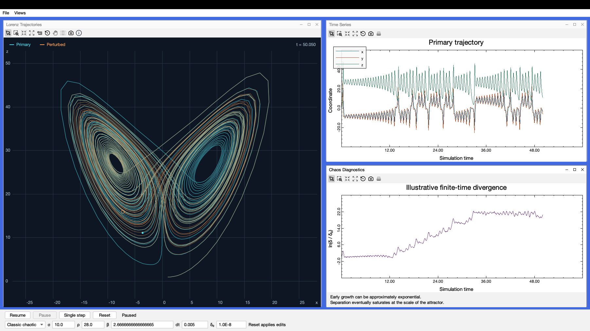

# MDI Chaos Lab

MDI Chaos Lab is a standalone Java 17 desktop simulation built on MDI 1.2.4. It advances two Lorenz systems with the same equations and parameters and a small difference in their starting positions. The desktop shows both trajectories in the x–z plane, the primary trajectory’s three coordinates on one sPlot chart, and a separate sPlot chart for divergence.



## Build and run

With Java 17 or newer and Maven, run the following from the project directory. Launching the application requires a graphical desktop. The tests run headlessly.

```sh
mvn clean verify
mvn exec:java
```

The entry point is `edu.cnu.mdi.chaos.app.ChaosApp`. The build uses the published `io.github.heddle:mdi:1.2.4` dependency.

## Explore the simulation

- **Start** begins from the initial conditions. **Pause** stops at the next worker batch boundary. **Resume** continues the same run.
- **Single step** advances both systems by one integration step from Ready or Paused and leaves the simulation paused.
- **Reset** validates and applies the parameter fields, clears every view’s history, and restores the initial conditions at time zero. Start or single-step to continue.
- **Presets** fill the fields for the classic chaotic regime, a system that approaches the origin (Fixed point), or one that approaches a nonzero equilibrium (Stable lobe). Reset applies the selected values.
- **Capture a trajectory image** with the camera in the Lorenz Trajectories toolbar. For the classic butterfly, run until the time display reaches about 65–85, then pause. The same toolbar provides navigation and view help.

## Scientific model

The equations are `dx/dt = σ(y − x)`, `dy/dt = x(ρ − z) − y`, and `dz/dt = xy − βz`. Both trajectories use classical fourth-order Runge–Kutta (RK4) in double precision. The primary starts at (1, 1, 1) and the perturbed trajectory starts at (1 + δ₀, 1, 1). The simulation clock is the step index multiplied by the fixed integration step. Wall-clock pacing controls animation speed.

| Parameter | Default | Accepted values |
| --- | ---: | --- |
| σ | 10 | 0.01–100 |
| ρ | 28 | 0–100 |
| β | 8/3 | 0.01–100 |
| dt | 0.005 | 0.0001–0.01 |
| δ₀ | 10⁻⁸ | 0 or 10⁻¹⁵–0.1 |

The diagnostic plots the natural log of the instantaneous Euclidean separation divided by δ₀. Locally exponential growth can appear as a roughly straight segment, with fluctuations over a finite interval. Once the trajectories are separated at the scale of the attractor, the separation stays bounded and the log curve can flatten or fluctuate. A fit across that saturated portion would misrepresent the growth rate. The display is illustrative and performs no slope fitting or perturbation renormalization. Undefined log values are omitted. For δ₀ = 0 the two trajectories coincide and the diagnostic is undefined. Very small positive δ₀ values also expose floating-point rounding in the actual initial displacement. Numerical overflow stops the run and displays an error.

## Execution and presentation

- `model` holds the headless RK4 integrator, validated parameters, immutable state and snapshot records, and a bounded ring. Continuous runs record a sample roughly every 0.02 simulated time units. Single steps are always recorded.
- `sim` adapts the model to MDI’s `SimulationEngine`. The worker alone mutates the model. It paces continuous integration in batches and MDI coalesces refresh events at roughly 25 Hz. Each EDT refresh reads the exact current state and copies only newly retained sample references under a short lock. The returned list and its samples are immutable.
- `app` and `view` coordinate controls, MDI drawing and sPlot on the EDT. Each history holds at most 6,000 samples. sPlot trims in blocks to amortize rebuilding its curve arrays. The oldest part of a long run eventually rolls off the display. Reset cancels the previous worker, clears the views, creates a new engine, and ignores callbacks from the retired engine.

MDI 1.2.4 exposes run, resume and pause, but no step-once transition. The app arms a one-shot flag while the engine is Ready or Paused, then requests run. The worker consumes that flag, advances both trajectories once, and requests pause before returning from its MDI step callback. MDI checks the pause flag on the same worker before invoking the callback again. The EDT keeps the run, pause and step buttons disabled until MDI confirms Paused. Reset can retire the engine while a command is pending.

The eight automated tests cover fourth-order convergence over a short interval, replay, reset, time, perturbation and divergence, bounded history, invalid inputs, and single-step behavior through the real MDI engine. Interactive fitting, renormalization and 3D are future work.
